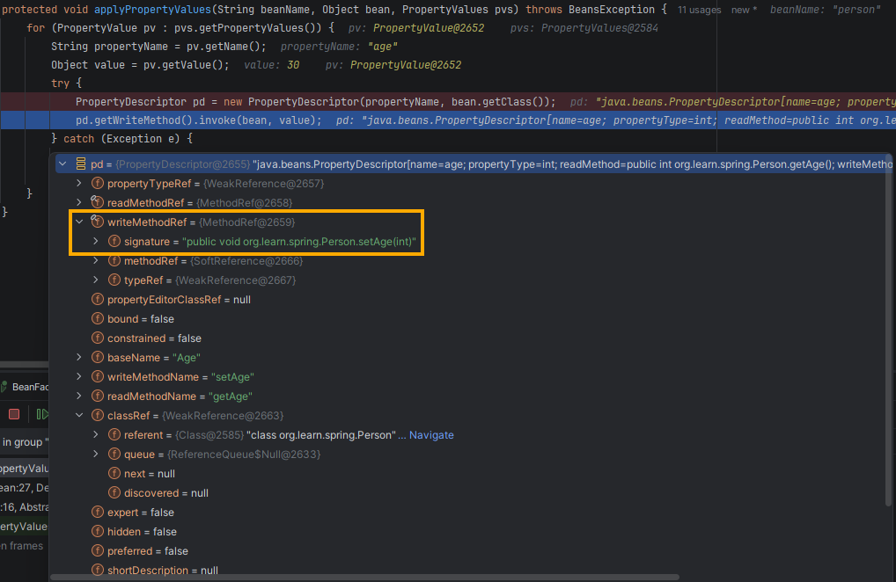

# learn-spring

## 1. Simple bean container

### Step 1 - Basic BeanFactory

#### Current design:

- `BeanDefinition`: wraps a single bean object.
- `BeanFactory`: holds registered `BeanDefinition`s in a `ConcurrentHashMap`. `getBean(name)` looks up by bean name and
  unwraps the stored bean object.

#### Notes:

- A bean is an instance of a class that the Spring container creates, owns, and manages.
- To name a bean, Spring uses the class name and converts the first letter to lowercase.
    ```java
    BeanDefinition beanDefinition = new BeanDefinition(new HelloService());
    beanFactory.registerBeanDefinition("helloService", beanDefinition);
    ```

### Step 2 - BeanFactory creates the bean

#### Why:

- In step 1, the caller created the bean (`new HelloService()`) and the factory only stored it. A container should own
  object creation: the caller describes the bean, and the factory builds it.

#### Changes:

- `BeanDefinition` holds the bean class instead of the bean object.
- `BeanFactory` is now an interface with only `getBean`, and `DefaultListableBeanFactory` implements it. Callers depend
  only on `getBean`, so the implementation can grow (parent classes, `ApplicationContext`) without affecting them.
- `getBean` calls `createBean`, which instantiates the class via reflection (`getDeclaredConstructor().newInstance()`).
  Exceptions from the reflection are wrapped in an unchecked `BeansException`, so callers of `getBean` are not forced to
  catch them. As [Spring's
  `BeansException` javadoc](https://github.com/spring-projects/spring-framework/blob/6.0.x/spring-beans/src/main/java/org/springframework/beans/BeansException.java#L26-L27)
  puts it: "Beans exceptions are usually fatal; there is no reason for them to be checked."

#### Differences from real Spring:

- `BeanFactory` and `DefaultListableBeanFactory` are the two ends of a longer chain:
  `DefaultSingletonBeanRegistry` → `AbstractBeanFactory` → `AbstractAutowireCapableBeanFactory` →
  `DefaultListableBeanFactory`. Every `ApplicationContext` uses a `DefaultListableBeanFactory` internally.
- Spring stores the bean class as `Object beanClass`: a class name (String) at first, resolved to a `Class` when the
  bean is created, so configuration can be read without loading classes. Here it is simplified to `Class<?>` until XML
  loading is added.

#### Next step:

- Every `getBean` call still creates a new instance. Step 3 will add a singleton cache to avoid that.

### Step 3 - Singleton cache

#### Changes:

- `DefaultListableBeanFactory` caches each bean it creates in a `singletonObjects` map. `getBean` returns the cached
  bean if present; otherwise it creates the bean and caches it. This is Spring's default singleton scope: one shared
  instance per bean name.
- Minor: both maps are `final`, and `getBean` declares `throws BeansException`, matching Spring's signatures.

#### Differences from real Spring:

- Spring keeps the cache in `DefaultSingletonBeanRegistry`, a parent class of the factory. Before 2.0 it lived in
  `AbstractBeanFactory`; Spring 2.0 RC2 moved it out into its own class, as the
  [2.0.x changelog](https://docs.spring.io/spring-framework/docs/2.0.x/changelog.txt) records:

  > Changes in version 2.0 RC2 (6.7.2006)
  >
  > * factored out SingletonBeanRegistry interface from ConfigurableBeanFactory interface
  > * factored out DefaultSingletonBeanRegistry base class from AbstractBeanFactory

- Checking the cache and creating the bean are not atomic, so two threads may create the same bean. Spring creates
  singletons inside a lock (`DefaultSingletonBeanRegistry.getSingleton(beanName, ObjectFactory)`).
- Every bean here is a singleton. Spring also supports `@Scope("prototype")`, which skips the cache and creates a new
  object on every `getBean`.

### Step 4 - Extract AbstractBeanFactory

#### Why:

- After step 3, `getBean` follows a fixed flow: check the cache, find the definition, create the bean, cache it. None of
  these steps depend on how bean definitions are stored, so the flow can be written once in a parent class.

#### Changes:

- New abstract class `AbstractBeanFactory` implements `getBean` and owns the singleton cache (`singletonObjects`,
  `getSingleton`, `addSingleton`).
- It leaves two steps to subclasses as abstract methods: `getBeanDefinition` (where definitions come from) and
  `createBean` (how a bean is built). `DefaultListableBeanFactory` extends it and implements both, using its definition
  map and reflection.
- This follows the [template method pattern](https://www.baeldung.com/java-template-method-pattern): `getBean` is the
  template method that fixes the order of the steps. The parent decides *when* things happen; the subclass decides
  *how*.

#### Differences from real Spring:

- `createBean` is implemented in `AbstractAutowireCapableBeanFactory`, a class between `AbstractBeanFactory` and
  `DefaultListableBeanFactory`. It will be added in later steps.
- Aside from `getBean(name)` implemented in `AbstractBeanFactory`, Spring also has a by-type `getBean(Class)`
  implemented in `DefaultListableBeanFactory`. Definitions are stored by name, so finding a bean by type means checking
  every definition, which only a factory that can list all its definitions can do.

### Step 5 - Property values

#### Changes:

- Add `PropertyValues` to `BeanDefinition`, so a definition describes both the class to create and the values to set on
  its properties. `createBean` now creates the instance (`createBeanInstance`), then sets the values
  (`applyPropertyValues`).

#### Notes:

- Difference between `BeanDefinition.getPropertyValues()` and `PropertyValues.getPropertyValues()`:
    - `BeanDefinition.getPropertyValues()`: returns the bean's property values container. It is the same mutable object
      every time, and the factory reads it at **creation time**. Proved by
      `testBeanGetsPropertyValuesFromDefinitionAtCreationTime`.
    - `PropertyValues.getPropertyValues()`: returns the container's `PropertyValue`s as an array. It is a snapshot (a
      new copy on every call), so modifying it does not alter the container. Proved by
      `testChangingPropertyValueArrayDoesNotChangeBeanDefinition`.
- Why use `PropertyDescriptor` in `applyPropertyValues`, using `testPropertyValuesAreApplied` as an example:
    - Spring's code doesn't know user classes like `Person`, so at compile time it can't directly use `setName` and
      `setAge`. `applyPropertyValues` uses reflection (through JavaBeans introspection) to find and call the setter
      dynamically.
    - `PropertyDescriptor` gives dynamic access to a property's getter and setter: `getWriteMethod()` returns the setter
      as a `Method`, and `invoke(bean, value)` calls it. In `Person person = (Person) beanFactory.getBean("person");`,
      the bean is requested for the first time, so `getBean` gets a cache miss and goes to `createBean`, then
      `applyPropertyValues`. As shown in the debugger screenshot, the `pd` for `age` has a `writeMethodRef` pointing to
      `public void org.learn.spring.Person.setAge(int)`:
      

#### Next step:

If a property's value is another bean (for example, a `Person` with a `Pet`), there's no suitable way to pass in the
value:

- If using the bean's name (`add("pet", "pet")`): `applyPropertyValues` passes each value to the setter as it is. It has
  no way to know that the String `"pet"` refers to a bean, so the call to `setPet(Pet)` fails with a type mismatch.
  Shown by `testBeanNameAsPropertyValueIsTreatedAsLiteralString`.
- If using the bean itself (`add("pet", beanFactory.getBean("pet"))`): this injects the right singleton, but each
  dependency must be created before the bean that needs it. For a circular dependency (`person` ↔ `pet`) no such order
  exists: whichever bean is created first misses its reference, so one direction always stays `null`. Shown by
  `testGetBeanAsPropertyValueCannotWireCircularDependency`.

Spring uses `RuntimeBeanReference` to state clearly that a value refers to another bean, not a String. The reference is
resolved when the bean is created, so the other bean only needs to be registered by then, not created in advance. The
next step adds `BeanReference`, a simplified version of `RuntimeBeanReference`. It makes a circular dependency
expressible, but resolving one still needs the bean to be cached before its properties are set (step 7).
